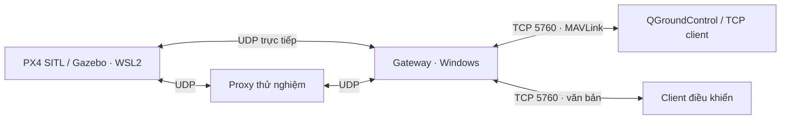

# MAVLink Gateway cho UAV PX4

Đồ án môn **Lập trình mạng**. Gateway viết bằng C++17 và Winsock trên Windows, nhận telemetry MAVLink từ PX4 SITL qua UDP, kiểm tra CRC, cung cấp dữ liệu cho nhiều TCP client và định tuyến lệnh trở lại UAV. Proxy tùy chọn mô phỏng mất khung, chèn trễ và lật bit để đánh giá chất lượng đường truyền.

## 1. Tính năng

| Nhóm | Chức năng |
|---|---|
| Tiếp nhận | Nhận UDP, phân tích MAVLink v1/v2, kiểm tra CRC và học endpoint của UAV từ `HEARTBEAT`. |
| Telemetry | Phân phối khung nhị phân cho nhiều TCP client, cung cấp trạng thái JSON qua giao thức văn bản. |
| Định tuyến | Chuyển lệnh đến UAV đích theo `sysid`, kiểm tra route và phát hiện mất liên lạc. |
| Điều khiển | Cấp khóa theo phiên TCP, hỗ trợ ARM, DISARM, TAKEOFF và LAND qua lệnh văn bản, theo dõi ACK và gửi lại khi hết hạn chờ. |
| Đo QoS | Ghi khung/s, ước lượng thiếu khung từ `seq`, độ dài cụm, jitter `ATTITUDE` và lỗi CRC. |
| Proxy thử nghiệm | Mô phỏng mất theo cụm bằng Markov, chèn trễ và lật bit payload. |

## 2. Kiến trúc



Chọn tuyến trực tiếp khi chạy demo hoặc đo mốc nền. Chọn tuyến qua proxy khi cần tạo lỗi có kiểm soát.

| Chế độ | Đích UDP của PX4 | UDP nhận tại gateway | TCP client |
|---|---|---|---|
| Trực tiếp | IP Windows, cổng `14550` | `14550` | `127.0.0.1:5760` |
| Qua proxy theo cấu hình đo | IP Windows, cổng `14550` của proxy | `14551`, nhận từ cổng nguồn proxy `14610` | `127.0.0.1:5760` |

Gateway học tuyến theo `sysid` và địa chỉ UDP nguồn từ heartbeat hợp lệ. Các khung hợp lệ tiếp theo từ đúng nguồn làm mới trạng thái liên lạc. Sau **3 giây** không nhận được khung hợp lệ từ UAV đã học, gateway đánh dấu UAV `OFFLINE`. Ở tuyến qua proxy, gateway gửi chiều ngược về endpoint của proxy và proxy chuyển tiếp tới PX4.

## 3. Yêu cầu hệ thống

- **Windows** — MinGW `g++` hỗ trợ C++17 trong `PATH`. Có thể dùng QGroundControl hoặc chương trình TCP client đi kèm.
- **WSL2 Ubuntu** — PX4-Autopilot và Gazebo đã được thiết lập để chạy SITL.
- **Python 3** — cần cho các script đo và kiểm thử. Cài thêm `pymavlink` để chạy các bài thử sử dụng UAV giả và `matplotlib` để vẽ biểu đồ.

Môi trường ghi trong đợt đo gồm Windows 11 Pro build 26200, Intel Core i5-12450H, WSL2 Ubuntu 24.04 ở chế độ NAT, MinGW GCC 6.3.0, PX4 SITL 1.18.0 và Gazebo Sim 8.15.0 với mô hình x500. Xem [hồ sơ môi trường](docs/moi_truong_do_K.md).

## 4. Cấu trúc thư mục

| Đường dẫn | Nội dung |
|---|---|
| [`src/gateway/`](src/gateway/) | Tiếp nhận UDP, định tuyến, quản lý UAV và client TCP. |
| [`src/client/`](src/client/) | TCP client nhị phân hiển thị telemetry. |
| [`src/proxy/`](src/proxy/) | Proxy Markov, chèn trễ, lật bit và ghi dữ liệu đối chiếu. |
| [`src/common/`](src/common/) | Codec MAVLink, bộ đo QoS, bộ theo dõi số thứ tự và cấu hình. |
| [`third_party/mavlink/`](third_party/mavlink/) | Header MAVLink dùng khi build. |
| [`scripts/`](scripts/) | Điều khiển, chạy phép đo, tổng hợp dữ liệu và vẽ biểu đồ. |
| [`docs/ketqua/`](docs/ketqua/) | CSV, nhật ký và biểu đồ thực nghiệm. |
| [`tests/`](tests/) | Kiểm thử C++ và Python. |
| [`build.bat`](build.bat), [`Makefile`](Makefile) | Lệnh build các chương trình Windows. |
| `bin/` | Tệp thực thi tạo sau khi build. |

## 5. Cài đặt và build

Giải nén `projectltm.rar` và mở thư mục chứa `build.bat`.

, chạy bằng PowerShell:

```powershell
g++ --version
.\build.bat
```

Script build với `-std=c++17 -O2`, liên kết `ws2_32` và tạo ba chương trình trong `bin\`: `gateway.exe`, `tcpclient.exe` và `upstream_markov_proxy.exe`.

## 6. Cấu hình PX4 và mạng

Trong WSL2, khởi động mô phỏng:

```bash
cd ~/PX4-Autopilot
make px4_sitl gz_x500
```

Với cấu hình WSL2 NAT, chạy `ip route show default` trong một terminal WSL khác và lấy địa chỉ sau `via` làm địa chỉ Windows.

Trong shell `pxh>`, chạy `mavlink status` để xem các instance đang phát. Nếu chưa có instance dùng cổng local `14600`, khởi động nó với lệnh dưới đây sau khi thay `172.26.160.1` bằng địa chỉ Windows của máy bạn:

```text
mavlink start -u 14600 -o 14550 -t 172.26.160.1 -r 100000
mavlink status
```

| Tham số | Ý nghĩa |
|---|---|
| `-u 14600` | Cổng UDP nguồn của phiên MAVLink PX4. |
| `-o 14550` | Cổng đích của gateway hoặc proxy trên Windows. |
| `-t <IP Windows>` | Địa chỉ Windows mà WSL2 sử dụng để gửi UDP. |
| `-r 100000` | Giới hạn cấu hình, tính bằng byte/giây. |

Nếu phiên MAVLink đã chạy, kiểm tra đích và cổng bằng `mavlink status` trước khi thay đổi. Giữ chế độ stream và giới hạn tốc độ nhất quán giữa các lượt cần so sánh.

## 7. Chạy hệ thống

### Gateway trực tiếp

```powershell
.\bin\gateway.exe
```

### Gateway qua proxy

Giữ PX4 gửi UDP tới cổng `14550` của Windows. Mở hai terminal PowerShell tại thư mục gốc dự án:

```powershell
# Terminal 1
.\bin\gateway.exe --udp-port 14551

# Terminal 2
.\bin\upstream_markov_proxy.exe --listen-port 14550 --gateway-port 14551 --gateway-source-port 14610 --sysid 1 --urb 0.05 --burst-packets 4 --lossgood 0 --lossbad 1 --seed 1001
```

Ví dụ tạo mất theo cụm ở mức mục tiêu 5%. Proxy sử dụng cấu hình Markov chiều thuận làm mặc định cho chiều ngược. Có thể ghi đè bằng các cờ `--reverse-*`. Thay `--sysid 1` nếu UAV đang dùng định danh khác.

### TCP client và QGroundControl

Mở một hoặc nhiều terminal Windows để theo dõi cùng luồng MAVLink:

```powershell
.\bin\tcpclient.exe 127.0.0.1 5760
```

Trong QGroundControl, tạo liên kết **TCP** đến `127.0.0.1:5760`. Khi kết nối hoạt động, gateway ghi UAV `ONLINE`, số khung nhận tăng và client cập nhật telemetry. Nếu gateway không nhận dữ liệu, kiểm tra địa chỉ đích trong `mavlink status`, tiến trình chiếm UDP `14550` và quyền nhận UDP của gateway trong Windows Firewall.

Client văn bản chạy ở terminal riêng:

```powershell
python scripts/control_client.py 127.0.0.1 5760
```

Nhập từng dòng sau khi client kết nối. Thay `1` bằng `sysid` đã quan sát. Gửi lệnh điều khiển trong SITL sau khi đã kiểm tra UAV đích và trạng thái mô phỏng.

```text
GET_DETAIL 1
SUBSCRIBE 2
ACQUIRE
COMMAND 1 ARM
```

Chờ `RESULT` và kiểm tra telemetry trước khi gửi lệnh kế tiếp. Dùng `RELEASE` để trả quyền.

## 8. Giao thức client ↔ gateway

Gateway phục vụ MAVLink nhị phân và giao thức văn bản trên cùng cổng TCP. Khung hợp lệ từ UAV được phân phối đến các client nhị phân. Client văn bản nhận dữ liệu `DETAIL` dạng JSON và phản hồi theo từng dòng kết thúc bằng `\n`. `DETAIL` tổng hợp từ `HEARTBEAT`, `SYS_STATUS`, `GPS_RAW_INT`, `ATTITUDE`, `GLOBAL_POSITION_INT` và `VFR_HUD`.

| Lệnh văn bản | Hành vi |
|---|---|
| `GET_DETAIL [sysid]` | Trả trạng thái UAV đang online. Khi không có đối tượng phù hợp, trả `DETAIL NONE`. |
| `SUBSCRIBE <hz>` / `UNSUBSCRIBE` | Bật hoặc tắt nhận `DETAIL` định kỳ. Tần số hợp lệ từ 1 đến 5 Hz. |
| `ACQUIRE` / `RELEASE` | Xin hoặc trả khóa điều khiển dùng chung. Khóa được giải phóng khi phiên giữ quyền ngắt kết nối. |
| `COMMAND <sysid> <ARM\|DISARM\|TAKEOFF\|LAND> [altitude_m]` | Gửi lệnh tới UAV đích khi phiên có quyền và UAV online. `TAKEOFF` nhận độ cao từ 1 đến 100 m, mặc định 10 m. |

`OK COMMAND_PENDING <sysid> <command>` báo yêu cầu đang chờ xử lý. Gateway trả `RESULT <sysid> <command> <result>` khi nhận ACK kết thúc, hoặc `RESULT <sysid> TIMEOUT` / `RESULT <sysid> OFFLINE` trong các trường hợp tương ứng. Đường lệnh văn bản chờ khoảng 1 giây trước khi xét gửi lại và giới hạn 3 lần gửi tổng cộng. ACK chấp nhận xác nhận phản hồi ở mức giao thức. Trạng thái thực hiện thao tác bay cần được kiểm tra qua telemetry hoặc Gazebo.

QGroundControl dùng đường MAVLink nhị phân. Một số lệnh điều khiển hợp lệ có thể tự lấy khóa khi khóa đang rảnh. Gateway áp dụng danh sách bản tin được phép, kiểm tra UAV đích và dùng chung khóa với client văn bản.

Một số lỗi thường gặp gồm `ERR LOCKED` khi khóa thuộc phiên khác, `ERR NOT_OWNER` khi phiên gửi lệnh chưa giữ khóa, `ERR UAV_OFFLINE` khi UAV đích mất liên lạc và `ERR COMMAND_BUSY` khi UAV đã có lệnh đang chờ.

## 9. Tham số cấu hình

| Tham số | Giá trị hoặc cách dùng |
|---|---|
| Cổng UDP gateway | Mặc định `14550`, đổi bằng `--udp-port`. |
| Cổng TCP gateway | `5760`. |
| Timeout UAV | `3 s` kể từ khung hợp lệ gần nhất của nguồn đã học. |
| Giới hạn TCP | Tối đa 10 client, hàng đợi 256 KiB mỗi client. Khi phân phối MAVLink nhị phân, gateway ngắt phiên nếu việc thêm khung vượt giới hạn. |
| Hàng đợi UDP | Tối đa 512 khung. |
| Đo tại gateway | `--measure-seconds` bật chế độ đo. Dùng `--scenario`, `--run-id` và `--output-dir` để đặt nhãn và nơi ghi kết quả. |
| Cổng proxy | `--listen-port`, `--gateway-port` và `--gateway-source-port`. Nên ghi rõ cả ba để khớp với tuyến đã chọn. |
| Markov tại proxy | `--urb` đặt tỷ phần trạng thái xấu mục tiêu. `--burst-packets` đặt độ dài trung bình trạng thái xấu theo khung. Chế độ theo thời gian dùng `--dur-s` và `--slot-ms`. |
| Lỗi tại proxy | `--lossgood` và `--lossbad` đặt xác suất thả theo trạng thái. `--delay-bad-min-ms` và `--delay-bad-max-ms` đặt khoảng trễ. `--flip-probability` đặt xác suất lật bit. |
| Tái lập lượt đo | Lưu seed cùng cấu hình và cửa sổ đo. Seed giúp tái lập quyết định với cùng đầu vào và thứ tự xử lý. |

## 10. Kết quả đo

Giá trị có dấu **±** biểu diễn trung bình và độ lệch chuẩn mẫu giữa các lượt. Đợt đo telemetry dùng một UAV PX4 SITL với `sysid=1`. Đo lệnh ARM dùng UAV giả trả ACK.

| Phép thử | Kết quả ghi nhận | Dữ liệu |
|---|---|---|
| Kiểm định bộ sinh lỗi với mục tiêu mất 5%, cụm trung bình 4 gói | Mất **4,850 ± 0,279%**, cụm trung bình **3,947 ± 0,090 gói**. | [K0](docs/ketqua/K0/20261114_172116/summary.csv) |
| Truyền trực tiếp qua gateway | **51,367 ± 0,055 khung/s**, không ghi nhận khoảng thiếu `seq` hoặc lỗi CRC. | [K1](docs/ketqua/K1/summary.csv) |
| Cùng mức mất mục tiêu 5%, khác độ dài cụm | Cụm thiếu trung bình tại gateway lần lượt **4,555** và **1,000 khung**. | [Cụm dài](docs/ketqua/K2/summary.csv), [cụm đơn](docs/ketqua/K3/summary.csv) |
| Tuyến qua proxy có chèn trễ | Jitter `ATTITUDE` **13,242 ± 1,319 ms**, so với **1,801 ± 0,154 ms** trên tuyến trực tiếp. | [K5](docs/ketqua/K5/summary.csv) |
| Gửi lệnh ARM với UAV giả | Tỷ lệ yêu cầu nhận ACK chấp nhận **100%, 96%, 100%** tại các mức mất mục tiêu **0%, 5%, 10%**. Số lần gửi lại trung bình tương ứng **0**, **0,080** và **0,160 lần/yêu cầu**. | [0%](docs/ketqua/K6/L0/summary.csv), [5%](docs/ketqua/K6/L5/summary.csv), [10%](docs/ketqua/K6/L10/summary.csv) |
| Lật bit payload | Proxy gửi **65** và **51** khung đã sửa. Gateway ghi **64** và **51** lỗi CRC. | [K7](docs/ketqua/K7/summary.csv) |
| Tạm dừng PX4 | Gateway báo `OFFLINE` sau **3,163 s**, tính từ lúc tạm dừng. | [K8](docs/ketqua/K8/20261114_180053/result.csv) |

**Cách đọc số liệu.** Gateway ước lượng khung thiếu từ `seq`; proxy đếm các khung thực sự bị thả. K2 có hai cửa sổ ghi riêng, còn K3 và K4 có dữ liệu đối chiếu trên phần cửa sổ giao nhau trong `common.csv`. Jitter là độ lệch chuẩn mẫu của các khoảng đến `ATTITUDE` được giữ lại. So sánh jitter giữa tuyến trực tiếp và tuyến có proxy phản ánh cả hiệu ứng của proxy lẫn thao tác chèn trễ. Phép thử ARM đánh giá ACK và retry ở gateway. Phép probe sau khi tiếp tục PX4 kiểm tra telemetry đến máy Windows.

## 11. Kiểm thử

Chạy từ thư mục gốc sau khi build, với các cổng thử nghiệm còn trống:

```powershell
.\scripts\run_test_stage1.bat
.\scripts\run_test_stage2.bat
python -m unittest discover -s tests -p "test_*.py"
```

Các ca kiểm thử bao gồm parser và CRC, giải mã telemetry, khóa điều khiển, giao tiếp nhị phân kiểu QGC và các chế độ đo qua proxy. Xem thêm [thư mục kiểm thử](tests/).

## 12. Định dạng log

| Tệp hoặc nhóm tệp | Nội dung |
|---|---|
| `*_gateway_ingress.csv` | Thống kê luồng tại gateway. Các trường gồm `t_s`, `frames_per_s`, `seq_gap_estimate`, `crc_errors` và các chỉ số `attitude_*`. |
| `*_gateway_ingress_bursts.csv` | Độ dài khoảng nhảy `seq` tại thời điểm phát hiện, ghi trong `gap_packets`. |
| `*_gateway_ingress_loss_seconds.csv` | Khoảng nhảy cộng gộp theo giây, dùng để xem diễn biến trong lượt. |
| `*_decision_trace.csv` của proxy | Quyết định giữ hoặc thả theo khung. Có thể đối chiếu theo `sysid`, `compid`, `seq` và `msgid`. |
| `result.csv` và `summary.csv` | Chỉ số từng lượt và bản tổng hợp của kịch bản. |
| `commands.csv` trong thử nghiệm ARM | Kết quả từng yêu cầu lệnh với UAV giả. |

`attitude_jitter_std_ms` là độ lệch chuẩn mẫu của khoảng đến. `attitude_jitter_max_ms` là độ lệch tuyệt đối lớn nhất so với khoảng đến trung bình. `attitude_skipped_loss` đếm các khoảng bị bỏ qua do phát hiện khoảng nhảy `seq`.

## 13. Hạn chế đã biết

- Đợt đo telemetry dùng một UAV PX4 SITL trên cùng một máy Windows/WSL2. Mã quản lý route theo nhiều `sysid`. Kết quả trong README phản ánh cấu hình một UAV đã đo.
- Trường `seq` 8 bit và dữ liệu đến sai thứ tự giới hạn phép ước lượng thiếu khung. Khung đến muộn có thể bù một khoảng thiếu đã ghi nếu còn trong cửa sổ theo dõi.
- Mốc jitter trực tiếp và bài chèn trễ dùng hai tuyến khác nhau. Chênh lệch quan sát bao gồm việc thêm proxy và thao tác chèn trễ.
- Phép thử ARM dùng UAV giả để đánh giá ACK/retry. Việc xác nhận thao tác bay cần telemetry hoặc trạng thái mô phỏng của bài thử tương ứng.

## 14. Xử lý sự cố

| Hiện tượng | Kiểm tra |
|---|---|
| Bind lỗi `10048` | Kiểm tra tiến trình đang giữ UDP `14550`, `14551` hoặc TCP `5760` bằng `Get-NetUDPEndpoint` hoặc `Get-NetTCPConnection`. Dừng tiến trình trùng cổng hoặc dùng cấu hình cổng phù hợp. |
| Gateway không thấy UAV `ONLINE` | Kiểm tra IP Windows, endpoint đích trong `mavlink status`, tuyến đang chọn và Windows Firewall. Nếu dùng proxy, đối chiếu cả ba cổng và `--sysid`. |
| QGroundControl không có telemetry | Kiểm tra kết nối TCP `127.0.0.1:5760` và xác nhận gateway đã học được route của UAV. |
| `ERR LOCKED` hoặc `ERR NOT_OWNER` | Kiểm tra phiên đang giữ quyền. Trả quyền hoặc đóng phiên cũ rồi xin lại bằng `ACQUIRE`. |
| CRC tăng trong bài lật bit | Đối chiếu số khung đã sửa và gửi tại proxy với bộ đếm CRC của gateway trong cửa sổ tương ứng. |
| Script đo báo xung đột cổng | Dừng gateway và proxy chạy tay. Chạy từng kịch bản tuần tự. |

## 15. Thành viên và đóng góp

| Thành viên | MSSV | Nhiệm vụ | Sản phẩm bàn giao | Tỷ lệ đóng góp |
|---|---|---|---|---:|
| Trần Đăng Duy | 106230042 | Thiết kế kiến trúc và triển khai gateway. Phụ trách kết nối UDP/TCP, kiểm tra CRC, phân phối MAVLink và xử lý lệnh. | Gateway, sơ đồ kiến trúc và nội dung triển khai. | 50% |
| Huỳnh Thiện Lộc | 106230052 | Phụ trách proxy tạo lỗi, chuẩn bị môi trường PX4 SITL và thực nghiệm. Tổng hợp số liệu về mất khung, jitter, CRC, ACK và timeout. | Proxy, nhật ký thử nghiệm, bảng số liệu và biểu đồ. | 50% |
| **Tổng cộng** | | | | **100%** |

## 16. Giấy phép

Bản mã nguồn được cung cấp chưa kèm tệp giấy phép cho phần mã của nhóm. Các header MAVLink trong `third_party/mavlink/` mang thông báo bản quyền riêng của thư viện.

## 17. Tài liệu tham khảo

- [MAVLink Developer Guide — Packet Serialization](https://mavlink.io/en/guide/serialization.html)
- [PX4 User Guide — Simulation](https://docs.px4.io/v1.18/en/simulation/)
- [Microsoft Learn — Windows Sockets 2](https://learn.microsoft.com/en-us/windows/win32/winsock/windows-sockets-start-page-2)
- [NTIA TM-23-565 — Relationships Between Gilbert–Elliott Burst Error Model Parameters and Error Statistics](https://its.ntia.gov/publications/download/TM-23-565.pdf)
- [Quy trình thực nghiệm](docs/huong_dan_do_K0_K7.md) và [kết quả tổng hợp của dự án](docs/bao_cao_ket_qua_do_lai.md).
