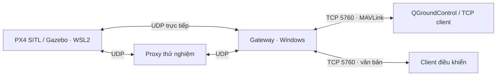

# MAVLink Gateway cho UAV PX4

Đồ án môn **Lập trình mạng**. Gateway viết bằng C++17 và Winsock trên Windows, nhận telemetry MAVLink từ PX4 SITL qua UDP, kiểm tra CRC, cung cấp dữ liệu cho nhiều TCP client và định tuyến lệnh trở lại UAV. Proxy tùy chọn mô phỏng mất khung, chèn trễ và lật bit để đánh giá chất lượng đường truyền.

## 1. Tính năng chính

| Nhóm | Chức năng |
|---|---|
| Tiếp nhận & Định tuyến | Nhận UDP, phân tích MAVLink v1/v2, kiểm tra CRC, học route theo `sysid` từ `HEARTBEAT`, phát hiện mất liên lạc sau **3 s**. |
| Telemetry & Điều khiển | Phân phối nhị phân cho nhiều TCP client (`5760`), cung cấp `DETAIL` JSON, cấp khóa phiên (`ACQUIRE`/`RELEASE`) và gửi lệnh (`ARM`, `DISARM`, `TAKEOFF`, `LAND`) có theo dõi ACK/retry. |
| Đo QoS & Proxy thử nghiệm | Ghi khung/s, ước lượng thiếu khung từ `seq`, jitter `ATTITUDE`, lỗi CRC; proxy mô phỏng mất theo cụm (Markov), chèn trễ và lật bit payload. |

## 2. Kiến trúc



| Chế độ | Đích UDP của PX4 | UDP nhận tại gateway | TCP client |
|---|---|---|---|
| Trực tiếp | IP Windows, cổng `14550` | `14550` | `127.0.0.1:5760` |
| Qua proxy theo cấu hình đo | IP Windows, cổng `14550` của proxy | `14551` (từ nguồn proxy `14610`) | `127.0.0.1:5760` |

## 3. Cấu trúc thư mục

| Đường dẫn | Nội dung |
|---|---|
| [`src/gateway/`](src/gateway/) | Tiếp nhận UDP, định tuyến, quản lý UAV và client TCP. |
| [`src/client/`](src/client/) | TCP client nhị phân hiển thị telemetry. |
| [`src/proxy/`](src/proxy/) | Proxy Markov, chèn trễ, lật bit và ghi dữ liệu đối chiếu. |
| [`src/common/`](src/common/) | Codec MAVLink, bộ đo QoS, bộ theo dõi `seq` và cấu hình. |
| [`third_party/mavlink/`](third_party/mavlink/) | Header MAVLink dùng khi build. |
| [`scripts/`](scripts/) | Script điều khiển, chạy đo K0–K8, tổng hợp CSV và vẽ biểu đồ. |
| [`docs/`](docs/) | Tài liệu chi tiết, hồ sơ môi trường đo và bảng tổng hợp QoS (`docs/ketqua/` sinh cục bộ khi đo). |
| [`tests/`](tests/) | Kiểm thử C++ và Python. |
| [`build.bat`](build.bat), [`Makefile`](Makefile) | Lệnh build các chương trình Windows vào `bin\`. |

## 4. Cài đặt & Chạy nhanh

**Yêu cầu:** Windows (MinGW `g++` hỗ trợ C++17 trong `PATH`), WSL2 Ubuntu (PX4 SITL + Gazebo), Python 3 (cài `pymavlink` cho UAV giả / test và `matplotlib` để vẽ biểu đồ). Xem [hồ sơ môi trường](docs/moi_truong_do_K.md).

**Build** (tại thư mục gốc bằng PowerShell):

```powershell
.\build.bat
```

Tạo 3 tệp trong `bin\`: `gateway.exe`, `tcpclient.exe`, `upstream_markov_proxy.exe`.

**Chạy gateway** (trực tiếp hoặc qua proxy):

```powershell
# Tuyến trực tiếp
.\bin\gateway.exe

# Hoặc tuyến qua proxy (2 terminal)
.\bin\gateway.exe --udp-port 14551
.\bin\upstream_markov_proxy.exe --listen-port 14550 --gateway-port 14551 --gateway-source-port 14610 --sysid 1 --urb 0.05 --burst-packets 4 --lossgood 0 --lossbad 1 --seed 1001
```

**Kết nối client / kiểm thử:**

```powershell
.\bin\tcpclient.exe 127.0.0.1 5760
python scripts/control_client.py 127.0.0.1 5760
```

Chạy bộ kiểm thử sau khi build (cần `pymavlink` và các cổng thử nghiệm trống):

```powershell
.\scripts\run_test_stage1.bat
.\scripts\run_test_stage2.bat
python -m unittest discover -s tests -p "test_*.py"
```

## 5. Tài liệu chi tiết

- [Giao thức, cấu hình PX4, tham số CLI & tổng quan scripts](docs/protocol_and_cli.md)
- [Kết quả đo (K0–K8), định dạng log, hạn chế & xử lý sự cố](docs/experiments_and_troubleshooting.md)
- [Hướng dẫn kiểm thử chi tiết](tests/README.md)
- [Hồ sơ môi trường đo](docs/moi_truong_do_K.md) và [bảng tổng hợp QoS gateway](docs/tong_hop_qos_gateway.csv)
- [Các chỉ số cần đo](cac_chi_so_can_do.md)

## 6. Thành viên và đóng góp

| Thành viên | MSSV | Nhiệm vụ | Sản phẩm bàn giao | Tỷ lệ đóng góp |
|---|---|---|---|---:|
| Trần Đăng Duy | 106230042 | Thiết kế kiến trúc và triển khai gateway. Phụ trách kết nối UDP/TCP, kiểm tra CRC, phân phối MAVLink và xử lý lệnh. | Gateway, sơ đồ kiến trúc và nội dung triển khai. | 50% |
| Huỳnh Thiện Lộc | 106230052 | Phụ trách proxy tạo lỗi, chuẩn bị môi trường PX4 SITL và thực nghiệm. Tổng hợp số liệu về mất khung, jitter, CRC, ACK và timeout. | Proxy, nhật ký thử nghiệm, bảng số liệu và biểu đồ. | 50% |
| **Tổng cộng** | | | | **100%** |

## 7. Giấy phép & Tham khảo

Mã nguồn chưa kèm tệp giấy phép cho phần mã của nhóm; các header trong `third_party/mavlink/` giữ thông báo bản quyền riêng.

- [MAVLink Developer Guide — Packet Serialization](https://mavlink.io/en/guide/serialization.html)
- [PX4 User Guide — Simulation](https://docs.px4.io/v1.18/en/simulation/)
- [Microsoft Learn — Windows Sockets 2](https://learn.microsoft.com/en-us/windows/win32/winsock/windows-sockets-start-page-2)
- [NTIA TM-23-565 — Gilbert–Elliott Burst Error Model](https://its.ntia.gov/publications/download/TM-23-565.pdf)
