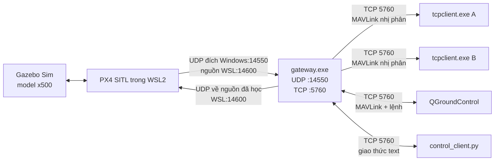
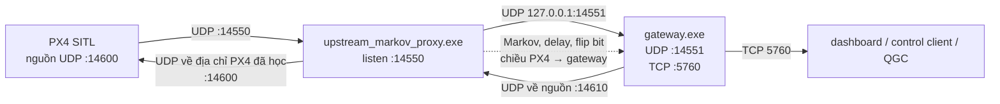
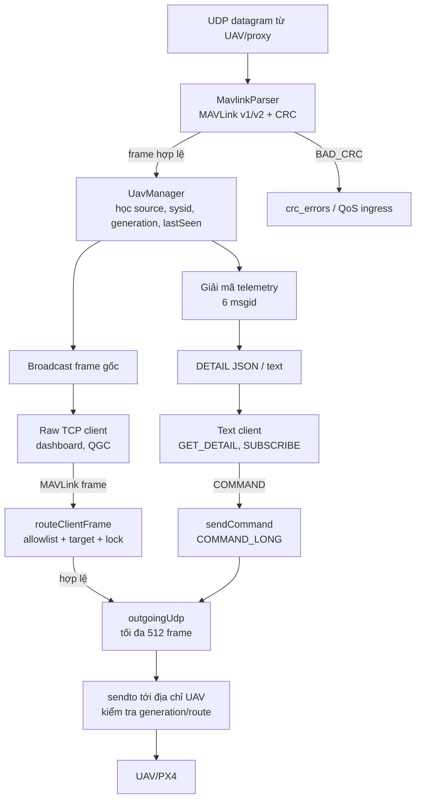
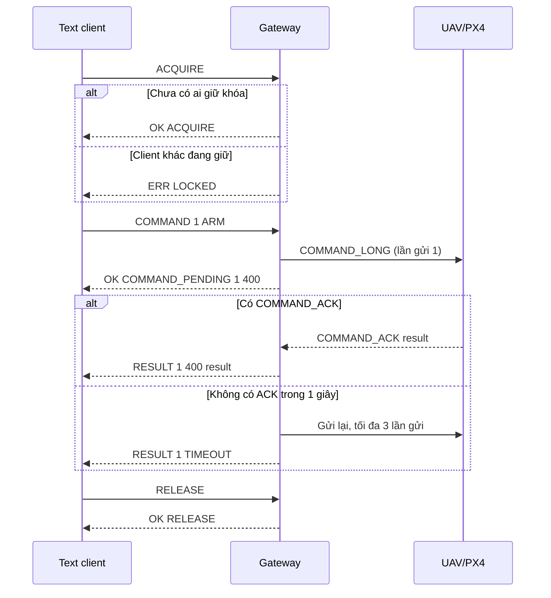

# PX4 MAVLink Gateway

Gateway C++/Winsock chạy trên Windows, nhận telemetry MAVLink từ PX4 SITL/Gazebo trong WSL2, chuyển tiếp frame đến nhiều client TCP và định tuyến lệnh điều khiển trở lại UAV. Dự án còn có proxy tạo lỗi Markov để đo chất lượng đường truyền và các script tổng hợp kết quả.

Tài liệu này bám theo mã nguồn, script và dữ liệu đo hiện có. Các kết luận chỉ áp dụng cho phạm vi đã kiểm chứng: **một UAV sysid 1**, PX4 SITL và gateway/proxy chạy trên cùng một máy Windows + WSL2. Phần hỗ trợ nhiều UAV có trong mã nguồn nhưng chưa có quy trình khởi động hai instance PX4 đầy đủ để tái hiện.

## 1. Chức năng chính

- Parse MAVLink v1/v2, kiểm tra CRC, đếm frame sai CRC và frame theo từng `msgid`.
- Học địa chỉ nguồn UDP của UAV từ `HEARTBEAT`, quản lý nhiều `sysid`, phát hiện xung đột nguồn và timeout sau 3 giây.
- Giải mã 6 nhóm telemetry: `HEARTBEAT`, `SYS_STATUS`, `GPS_RAW_INT`, `ATTITUDE`, `GLOBAL_POSITION_INT`, `VFR_HUD`.
- Chuyển tiếp **mọi frame MAVLink hợp lệ** từ UAV đã học đến các client TCP nhị phân; text client nhận `DETAIL` dạng JSON theo yêu cầu hoặc theo tần số `SUBSCRIBE`.
- Định tuyến MAVLink từ client TCP về UAV theo `target_system`, có allowlist cho QGroundControl và khóa điều khiển dùng chung.
- Hỗ trợ giao thức văn bản để xem telemetry, giành/trả khóa và gửi `ARM`, `DISARM`, `TAKEOFF`, `LAND`.
- Gửi lại lệnh sau 1 giây nếu chưa có `COMMAND_ACK`, tối đa 3 lần gửi, sau đó trả `RESULT ... TIMEOUT`.
- Đo loss theo sequence, frame/s, jitter `ATTITUDE`; proxy mô phỏng mất gói Markov, thêm trễ và lật bit.
- Tự gửi `HEARTBEAT` GCS (sysid 255) đến UAV online mỗi 1 giây.

## 2. Kiến trúc và luồng dữ liệu

### 2.1. Triển khai trực tiếp (K1, K8, demo thường)



- PX4 gửi đến `Windows:14550`; gateway bind `0.0.0.0:14550` và học địa chỉ nguồn từ frame `HEARTBEAT` đầu tiên của UAV.
- Các frame sau đó chỉ được chấp nhận nếu đến đúng endpoint đã học. Khi UAV online, `HEARTBEAT` từ endpoint khác bị bỏ qua và ghi log `CONFLICT`.
- Mọi frame hợp lệ từ endpoint đã học đều cập nhật `lastSeen`, không chỉ `HEARTBEAT`. Vì vậy timeout 3 giây dựa trên hoạt động MAVLink thực tế của UAV.
- Gateway gửi lệnh và heartbeat GCS về đúng địa chỉ nguồn đã học. Trong demo, đó là cổng UDP local 14600 của PX4.
- TCP 5760 là cổng duy nhất cho cả dashboard nhị phân, text client và QGC. Gateway tự phân biệt text/raw theo byte đầu tiên của kết nối.

### 2.2. Triển khai qua proxy (K2–K5, K7)



- Script đo đặt proxy nghe `14550`, chuyển tiếp đến gateway `127.0.0.1:14551` và dùng cổng nguồn `14610`.
- Gateway học proxy là nguồn UAV; chiều ngược gateway gửi về `14610`, proxy chuyển tiếp về địa chỉ PX4 đã học.
- Proxy chỉ chấp nhận frame có `sysid` bằng `--sysid` (mặc định 1) và học địa chỉ PX4 từ frame hợp lệ đầu tiên.
- K6 dùng UAV giả thay PX4 và cổng riêng: UAV giả → proxy `14650` → gateway `14651`; chiều ngược gateway → proxy `14660` → UAV giả.

### 2.3. Luồng nội bộ gateway



Điểm quan trọng:

- Frame hợp lệ từ nguồn lạ không có `HEARTBEAT` không tự tạo UAV mới; chỉ `HEARTBEAT` hợp lệ mới đăng ký route.
- Frame MAVLink hợp lệ nhưng không thuộc 6 msgid telemetry vẫn được forward nguyên bản đến raw client.
- Hàng đợi UDP kiểm tra lại route trước khi gửi. Nếu UAV offline hoặc `generation` đổi, frame bị hủy và tăng `droppedUdpFrames`.
- Text client không nhận broadcast nhị phân; text client nhận các dòng `DETAIL`, `RESULT`, `OK`, `ERR`.

### 2.4. Trình tự điều khiển, ACK và khóa



- `COMMAND_ACK` có `MAV_RESULT_IN_PROGRESS` chỉ làm mới mốc thời gian chờ, chưa kết thúc lệnh.
- Nếu UAV offline hoặc route đổi `generation`, gateway trả `RESULT <sysid> OFFLINE` và hủy lệnh đang chờ.
- Mỗi `sysid` chỉ có một lệnh đang chờ; lệnh mới trả `ERR COMMAND_BUSY`.
- QGC dùng chung khóa với text client. QGC tự giành khóa ở frame điều khiển đầu tiên **sau khi** đã có route đến UAV; lệnh điều khiển có `target_system=0` bị chặn.

## 3. Yêu cầu môi trường

| Nơi chạy | Thành phần |
|---|---|
| Windows | MinGW `g++` hỗ trợ C++17, Winsock2, PowerShell hoặc CMD |
| Windows, tùy nhu cầu | Python 3, `pymavlink` cho script đo/kiểm thử; QGroundControl cho giao diện MAVLink |
| WSL2 Ubuntu | PX4-Autopilot đã cài phụ thuộc SITL và Gazebo tương thích |
| Mạng | UDP 14550/14551/14600/14610 và TCP 5760 không bị tiến trình khác chiếm |

Môi trường đã đo: Windows 11 Pro build 26200, Intel i5-12450H, RAM khoảng 15,63 GiB; WSL2 Ubuntu 24.04 dùng NAT; PX4 1.18.0 nhánh `main`; Gazebo Sim 8.15.0, model `x500_0` có GUI. Chi tiết và nguồn xác minh ở [docs/moi_truong_do_K.md](docs/moi_truong_do_K.md). Repo không chứa bộ cài PX4/Gazebo.

## 4. Biên dịch

**PowerShell tại thư mục gốc repo**, với `g++` có trong `PATH`:

```powershell
g++ --version
.\build.bat
```

Trong CMD dùng `build.bat`. Script dùng `-std=c++17 -O2`, liên kết `-lws2_32` và tạo:

- `bin\gateway.exe`
- `bin\tcpclient.exe`
- `bin\upstream_markov_proxy.exe`

`Makefile` tạo cùng ba chương trình. Các test C++ trong `tests/` được biên dịch riêng, không nằm trong `build.bat`.

Cài `pymavlink` nếu chạy script đo/kiểm thử:

```powershell
python -m pip install pymavlink
```

## 5. Chạy demo một UAV

### 5.1. Khởi động PX4 SITL/Gazebo

Trong **WSL2 Ubuntu**, tại thư mục PX4 đã cài:

```bash
cd ~/PX4-Autopilot
make px4_sitl gz_x500
```

Target khởi động phụ thuộc bản PX4 đã cài. Repo không đóng gói PX4.

### 5.2. Xác định IP Windows

Mở **cửa sổ WSL2 khác**:

```bash
ip route show default
```

Lấy địa chỉ sau `via`. Trong lần đo, IP Windows là `172.26.160.1`; cần xác định lại trên máy demo vì mạng NAT có thể đổi.

### 5.3. Mở gateway trên Windows

```powershell
.\bin\gateway.exe
```

Mặc định gateway nghe UDP `14550`, TCP `5760`. Có thể đổi cổng UDP:

```powershell
.\bin\gateway.exe --udp-port 14551
```

### 5.4. Cấu hình PX4 gửi telemetry

Trong shell `pxh>` của PX4, kiểm tra instance hiện có:

```text
mavlink status
```

Nếu chưa có instance local 14600, chạy (thay IP Windows):

```text
mavlink start -u 14600 -o 14550 -t 172.26.160.1 -r 100000
mavlink stream -u 14600 -s HEARTBEAT -r 1
mavlink stream -u 14600 -s ATTITUDE -r 10
mavlink status
```

Có thể bật thêm các stream để dashboard có đủ dữ liệu:

```text
mavlink stream -u 14600 -s SYS_STATUS -r 2
mavlink stream -u 14600 -s GPS_RAW_INT -r 2
mavlink stream -u 14600 -s GLOBAL_POSITION_INT -r 5
mavlink stream -u 14600 -s VFR_HUD -r 2
```

Giữ nguyên stream/rate khi so sánh các phép đo. Nếu instance 14600 đã tồn tại, kiểm tra đích hiện tại thay vì khởi động trùng. Cho phép UDP 14550 qua Windows Firewall nếu WSL2 bị chặn.

### 5.5. Mở hai dashboard

Mỗi cửa sổ PowerShell:

```powershell
.\bin\tcpclient.exe 127.0.0.1 5760
```

Thành công khi cả hai dashboard hiển thị cùng `SYSID` (thường là 1), trạng thái `ONLINE`, số frame tăng và telemetry cập nhật. Nếu còn chờ dữ liệu, kiểm tra IP đích PX4, firewall và tiến trình khác đang chiếm UDP 14550.

### 5.6. Client văn bản và QGroundControl

Mở client văn bản:

```powershell
python scripts/control_client.py 127.0.0.1 5760
```

Nhập từng dòng; thay `1` bằng sysid quan sát được:

```text
GET_DETAIL 1
SUBSCRIBE 2
ACQUIRE
COMMAND 1 ARM
COMMAND 1 TAKEOFF 5
COMMAND 1 LAND
COMMAND 1 DISARM
RELEASE
```

Chờ `RESULT` và telemetry xác nhận từng bước trước khi gửi bước tiếp theo. `OK COMMAND_PENDING` chỉ xác nhận gateway đã nhận lệnh; `RESULT` mới báo ACK/timeout. PX4 có thể từ chối nếu chưa đủ điều kiện bay.

Trong QGroundControl trên Windows, tạo kết nối **TCP**, host `127.0.0.1`, port `5760`, rồi kết nối. QGC có thể xem telemetry, đổi mode, gửi ARM/TAKEOFF/LAND và joystick qua gateway. Client đang giữ khóa phải `RELEASE` hoặc ngắt kết nối trước khi client khác điều khiển.

## 6. Giao thức

### 6.1. Giao thức văn bản trên TCP 5760

Mỗi dòng kết thúc bằng `\n`. Gateway tự chuyển kết nối sang text mode khi byte đầu tiên là chữ cái.

| Lệnh | Phản hồi | Ghi chú |
|---|---|---|
| `GET_DETAIL` | Nhiều dòng `DETAIL {json}` hoặc `DETAIL NONE` | Trả tất cả UAV online |
| `GET_DETAIL <sysid>` | `DETAIL {json}` hoặc `DETAIL NONE` | Trả một UAV |
| `SUBSCRIBE <1..5>` | `OK SUBSCRIBE <hz>` | Đẩy `DETAIL` định kỳ theo Hz |
| `UNSUBSCRIBE` | `OK UNSUBSCRIBE` | Dừng đẩy định kỳ |
| `ACQUIRE` | `OK ACQUIRE` / `ERR LOCKED` | Giành khóa điều khiển |
| `RELEASE` | `OK RELEASE` / `ERR NOT_OWNER` | Trả khóa và hủy lệnh chờ của client |
| `COMMAND <sysid> ARM` | `OK COMMAND_PENDING <sysid> 400` | `MAV_CMD_COMPONENT_ARM_DISARM`, `param1=1` |
| `COMMAND <sysid> DISARM` | `OK COMMAND_PENDING <sysid> 400` | `param1=0` |
| `COMMAND <sysid> TAKEOFF [alt]` | `OK COMMAND_PENDING <sysid> 22` | Độ cao 1–100 m, mặc định 10 m |
| `COMMAND <sysid> LAND` | `OK COMMAND_PENDING <sysid> 21` | `MAV_CMD_NAV_LAND` |

Phản hồi bất đồng bộ:

- `RESULT <sysid> <command> <result>` khi nhận `COMMAND_ACK` cuối cùng.
- `RESULT <sysid> TIMEOUT` sau 3 lần gửi mà không có ACK cuối.
- `RESULT <sysid> OFFLINE` khi UAV mất route trong lúc chờ.

Lỗi thường gặp: `ERR NOT_OWNER`, `ERR UAV_OFFLINE`, `ERR COMMAND_BUSY`, `ERR ALTITUDE 1..100`, `ERR UNKNOWN_COMMAND`, `ERR USAGE ...`.

### 6.2. Telemetry được giải mã

| MsgID | Tên | Trường tiêu biểu |
|---:|---|---|
| 0 | `HEARTBEAT` | armed, flight mode PX4, type, autopilot, system status |
| 1 | `SYS_STATUS` | voltage, current, battery remaining |
| 24 | `GPS_RAW_INT` | fix type, satellites visible |
| 30 | `ATTITUDE` | roll, pitch, yaw, roll/pitch/yaw speed |
| 33 | `GLOBAL_POSITION_INT` | lat, lon, altitude MSL/relative, vx/vy/vz, heading |
| 74 | `VFR_HUD` | airspeed, groundspeed, climb rate, throttle |

Frame hợp lệ khác vẫn được forward nguyên bản đến raw TCP client nhưng không xuất hiện trong `DETAIL`.

### 6.3. Chính sách MAVLink từ client TCP/QGC

| Nhóm | Được phép |
|---|---|
| Telemetry/khám phá | `PING`, `PARAM_REQUEST_READ/LIST`, `PARAM_EXT_REQUEST_READ/LIST`, `REQUEST_DATA_STREAM`, `REQUEST_EVENT`, `TIMESYNC`, `MISSION_REQUEST_LIST/INT/REQUEST`, `MISSION_ACK` |
| Lệnh telemetry | `COMMAND_LONG/INT` với `GET_MESSAGE_INTERVAL`, `SET_MESSAGE_INTERVAL`, `REQUEST_MESSAGE`, `REQUEST_PROTOCOL_VERSION`, `REQUEST_AUTOPILOT_CAPABILITIES`, `RUN_PREARM_CHECKS`, `GET_HOME_POSITION` |
| Điều khiển | `SET_MODE`, `MANUAL_CONTROL`, `COMMAND_LONG/INT` với ARM/DISARM (400), TAKEOFF (22), LAND (21), DO_SET_MODE (176) |
| Bị chặn | Lệnh bay có `target_system=0`; `SET_MESSAGE_INTERVAL` có target 0; msgid ngoài allowlist; điều khiển khi client khác giữ khóa |
| Heartbeat từ client | Bị bỏ qua; gateway tự gửi heartbeat GCS sysid 255 mỗi 1 giây |

## 7. Cấu hình, cổng và tham số

### 7.1. Giá trị mặc định trong `src/common/config.h`

| Tham số | Giá trị |
|---|---:|
| UDP ingress | 14550 |
| TCP listener | 5760 |
| Timeout UAV | 3 giây |
| Chu kỳ in thống kê | 5 giây |
| Xóa nguồn UDP idle | 30 giây |
| `select()` timeout | 200 ms |
| Số client tối đa | 10 |
| Hàng đợi TCP mỗi client | 256 KiB |
| Hàng đợi UDP | 512 frame |
| Số nguồn UDP tối đa | 32 |

### 7.2. Tham số dòng lệnh

`gateway.exe`:

```text
gateway.exe [--udp-port PORT]
            [--measure-seconds SECONDS --scenario NAME --run-id ID --output-dir DIR]
```

- `--udp-port`: đổi cổng UDP ingress; TCP vẫn cố định 5760.
- `--measure-seconds`: bật chế độ đo QoS và xuất CSV.
- `--scenario`, `--run-id`, `--output-dir`: dùng khi đo; mặc định `DEFAULT`, timestamp hiện tại, `docs/ketqua`.

`upstream_markov_proxy.exe`:

| Cờ | Mặc định | Ý nghĩa |
|---|---:|---|
| `--listen-port` | 14551 | Cổng UDP nhận frame từ PX4/UAV giả |
| `--gateway-port` | 14550 | Cổng UDP của gateway |
| `--gateway-source-port` | 14610 | Cổng nguồn proxy dùng để gateway gửi ngược |
| `--sysid` | 1 | Chỉ xử lý frame của sysid này |
| `--urb` | 0.5 | Tỷ lệ thời gian ở trạng thái xấu |
| `--dur-s` | 2.0 | Độ dài trung bình cụm xấu theo thời gian |
| `--slot-ms` | 100 | Bước thời gian Markov |
| `--burst-packets` | tắt | Bật Markov theo frame; cụm xấu trung bình bằng số này |
| `--lossgood` | 0.0 | Xác suất mất frame ở trạng thái tốt |
| `--lossbad` | 1.0 | Xác suất mất frame ở trạng thái xấu |
| `--flip-probability` | 0.0 | Xác suất lật 1 bit payload (0–1) |
| `--delay-bad-min-ms` | 0 | Trễ tối thiểu cho frame ở trạng thái xấu |
| `--delay-bad-max-ms` | 0 | Trễ tối đa; 0 là tắt delay |
| `--seed` | 1 | Seed Markov/ngẫu nhiên |
| `--reverse-*` | sao chép chiều thuận, seed đảo | Ghi đè tham số Markov chiều gateway → PX4 |

`--measure-seconds` bật ghi CSV. Nếu không truyền `--output-dir`, proxy dùng thư mục mặc định `docs/ketqua/PBL3-19_GatewayMarkov/upstream/<run_id>`.

### 7.3. Bảng cổng theo kịch bản

| Kịch bản | PX4/UAV → | Proxy → gateway | Gateway → proxy | Gateway TCP |
|---|---|---|---|---|
| Demo, K1, K8 | `Windows:14550` | không dùng | về nguồn PX4 `:14600` | 5760 |
| K2–K5, K7 | `Windows:14550` | `127.0.0.1:14551` | `127.0.0.1:14610` | 5760 |
| K6 (UAV giả) | `127.0.0.1:14650` | `127.0.0.1:14651` | `127.0.0.1:14660` | 5760 |

Proxy mặc định (`14551 → 14550`) dành cho chạy tay khi gateway vẫn ở cổng mặc định. Script đo K2–K5/K7 đảo lại (`14550 → 14551`) để PX4 vẫn gửi đến 14550 như cấu hình đã dùng.

## 8. Đo QoS và tái lập kết quả

### 8.1. Định nghĩa phép đo

- **Frame gateway**: frame MAVLink hợp lệ sau CRC, thuộc UAV đã học.
- **Loss gateway**: `seq_gap_estimate / (frames + seq_gap_estimate)`, ước lượng từ khoảng trống sequence.
- **Loss proxy**: `frames_dropped_markov / frames_pre` trong cửa sổ đo. Đây là loss do proxy thả, không phải loss gateway quan sát.
- **Jitter**: độ lệch chuẩn mẫu của khoảng cách giữa các frame `ATTITUDE` tại gateway. Các khoảng có gap MAVLink bị bỏ qua. Đây **không phải** độ trễ một chiều.
- **Warm-up**: 5 giây đầu sau frame hợp lệ đầu tiên không tính. Gateway và proxy dùng cùng độ dài cửa sổ; proxy đặt chung mốc bắt đầu cho recorder trước và sau.
- **K7**: proxy lật bit payload nhưng không tính lại CRC, nên gateway loại frame với `BAD_CRC`; vì vậy loss Markov bằng 0 nhưng loss/CRC tại gateway tăng.

### 8.2. Chạy K0–K8

K0 kiểm định bộ sinh Markov bằng 100.000 gói tổng hợp mỗi lượt, nhiều seed, không dùng PX4. Mã ở `tests/markov_k0.cpp`, tổng hợp bằng `scripts/summarize_k0.py`.

K1–K5, K7 dùng `scripts/run_k_live.py`. Giữ PX4 gửi đến `Windows:14550`, dừng gateway/proxy/client demo, rồi chạy lần lượt tại gốc repo:

```powershell
python -B scripts/run_k_live.py K1 --repeats 3 --seconds 120
python -B scripts/run_k_live.py K2 --repeats 3 --seconds 120
python -B scripts/run_k_live.py K3 --repeats 2 --seconds 60
python -B scripts/run_k_live.py K4 --repeats 2 --seconds 60
python -B scripts/run_k_live.py K5 --repeats 2 --seconds 60
python -B scripts/run_k_live.py K7 --repeats 2 --seconds 60
```

Script tự mở gateway/proxy, chờ đủ cửa sổ đo, ghi CSV/log vào `docs/ketqua/<K>/<run_id>/` và cập nhật `summary.csv`. Không chạy đồng thời vì dùng chung cổng.

K6 dùng UAV giả và cổng riêng:

```powershell
python -B scripts/run_k6.py --loss 0  --repeats 2 --commands 50 --seconds 120
python -B scripts/run_k6.py --loss 5  --repeats 2 --commands 50 --seconds 120
python -B scripts/run_k6.py --loss 10 --repeats 2 --commands 50 --seconds 120
```

K8 đo timeout bằng cách tạm dừng PX4:

```powershell
python scripts/measure_timeout_px4.py --allow-terminal-stop
```

Lệnh này gửi `SIGSTOP` rồi `SIGCONT`; có thể cần `fg` lại terminal PX4. Script chỉ đo thời điểm gateway ghi log `OFFLINE`; không kiểm chứng đầy đủ việc gateway phục hồi sau `SIGCONT`.

## 9. Kết quả đo

Các số là **trung bình ± độ lệch chuẩn mẫu giữa các lượt**, giữ nguyên từ `summary.csv`. K1–K2 chạy 3 lượt × 120 giây; K3–K5, K7 chạy 2 lượt × 60 giây.

| Kịch bản và điều kiện | Loss gateway (%) | Loss proxy (%) | Gateway (frame/s) | Jitter ATTITUDE tại gateway (ms) | Nguồn |
|---|---:|---:|---:|---:|---|
| K1: trực tiếp, không proxy; 3 × 120 s | 0 ± 0 | Không áp dụng | 51,3667 ± 0,0550 | 1,8007 ± 0,1536 | [CSV K1](docs/ketqua/K1/summary.csv) |
| K2: Markov 5%, cụm TB 4 frame, hai chiều; 3 × 120 s | 4,8920 ± 0,9551 | 4,7013 ± 0,8718 | 48,8753 ± 0,5064 | 2,5453 ± 1,0864 | [CSV K2](docs/ketqua/K2/summary.csv) |
| K3: Markov 5%, cụm TB 1 frame, hai chiều; 2 × 60 s | 4,3120 ± 0,2744 | 4,3120 ± 0,3196 | 49,1915 ± 0,1294 | 2,8465 ± 0,0233 | [CSV K3](docs/ketqua/K3/summary.csv) |
| K4: Markov 10%, cụm TB 4 frame, hai chiều; 2 × 60 s | 10,0290 ± 0,5105 | 10,2185 ± 0,8761 | 47,7750 ± 0,4837 | 4,1020 ± 2,4027 | [CSV K4](docs/ketqua/K4/summary.csv) |

Các kịch bản còn lại:

| Kịch bản | Điều kiện chính | Kết quả chính | Nguồn |
|---|---|---|---|
| K5 | Không thả gói; Markov 10%, cụm 0,4 s; delay 20–80 ms ở trạng thái xấu; 2 × 60 s | Loss 0%; jitter `13,2415 ± 1,3188` ms; `398 ± 87,7` frame bị trễ; delay đặt `49,7565` ms, quan sát `56,592` ms | [K5](docs/ketqua/K5/kich_ban_va_ket_qua.md) |
| K6 | UAV giả trả ACK cho ARM; loss 0/5/10%, cụm 4 frame; 50 lệnh/mức, 2 lượt | Thành công `100%` / `96,0 ± 5,7%` / `100%`; retry trung bình `0` / `0,08` / `0,16` lệnh | [K6](docs/ketqua/K6/kich_ban_va_ket_qua.md) |
| K7 | Lật 1 bit payload với xác suất 2%; 2 × 60 s | Loss gateway `1,828 ± 0,293%`; `57,5 ± 9,2` lỗi CRC; `58,0 ± 9,9` frame bị lật đã gửi | [K7](docs/ketqua/K7/kich_ban_va_ket_qua.md) |
| K8 | `SIGSTOP` PX4 để đo timeout; 1 lượt | Phát hiện offline sau `3,163` s với ngưỡng 3 s | [K8](docs/ketqua/K8/kich_ban_va_ket_qua.md) |

Nhận xét có cơ sở từ dữ liệu:

- K1 là mốc nền: gần 51,37 frame/s, không mất frame, jitter khoảng 1,8 ms.
- K2–K4 cho thấy loss gateway tăng theo mức Markov và proxy; jitter cũng tăng khi có mất gói/trễ.
- K5 cho thấy thêm trễ làm jitter tăng mạnh dù loss bằng 0.
- K7 cho thấy lật bit làm CRC fail tại gateway; loss do Markov bằng 0 nhưng frame không đến được client.
- K6 chỉ chứng minh cơ chế ACK/retry với UAV giả, **không** chứng minh chuyến bay PX4 thật thành công.
- K8 chỉ có một lượt; chưa đủ để kết luận phân bố timeout.

Xem [mục lục kết quả](docs/ketqua/kich_ban_va_ket_qua.md) và từng thư mục K0–K8 để có bảng đầy đủ, log và CSV chi tiết.

## 10. Kiểm thử

- Test C++: `tests/test_stage1_framing.cpp`, `tests/test_stage2_telemetry.cpp`, `tests/test_sequence_cases.cpp`, `tests/markov_k0.cpp`.
- Script tiện lợi: `scripts/run_test_stage1.bat`, `scripts/run_test_stage2.bat`.
- Test tích hợp Python: `tests/test_control_protocol.py`, `test_qgc_control.py`, `test_measurement_modes.py`, `test_reverse_markov.py`, `test_live_runner.py`.
- Hướng dẫn gốc ở [tests/README.md](tests/README.md).

Chạy test Python khi đã cài `pymavlink`, đã build `bin\gateway.exe` và không có tiến trình khác chiếm cổng 5760/14564/14600:

```powershell
python -m unittest discover -s tests -p "test_*.py"
```

Một số test mở cổng và tạo file tạm trong `docs/ketqua`; nên chạy khi không có phiên đo thật.

## 11. Cấu trúc thư mục

| Đường dẫn | Nội dung |
|---|---|
| `src/common/` | Cấu hình, codec MAVLink, QoS, Markov, sequence tracker, tiện ích thời gian |
| `src/gateway/` | Gateway, quản lý UAV, quản lý client TCP, thống kê |
| `src/client/` | Dashboard C++ `tcpclient.exe` |
| `src/proxy/` | Proxy Markov `upstream_markov_proxy.exe` |
| `third_party/mavlink/` | Header thư viện MAVLink |
| `scripts/` | Client điều khiển, probe, chạy K1–K8, tổng hợp và vẽ kết quả |
| `tests/` | Test C++/Python và hướng dẫn kiểm thử |
| `docs/ketqua/` | CSV, log, `kich_ban_va_ket_qua.md` của K0–K8 |
| `docs/moi_truong_do_K.md` | Môi trường và tham số đã xác minh |
| `bin/` | Chương trình sau khi biên dịch; không chứa log đo |
| `logs/` | Chỉ có `.gitkeep`; log đo thực tế nằm trong `docs/ketqua/<K>/<run_id>/` |
| `build.bat`, `Makefile` | Biên dịch ba chương trình Windows |

## 12. Thành viên và phân công

Repo hiện không có bảng MSSV, phân công hay tài khoản GitHub. Lịch sử git chỉ ghi nhận hai tên tác giả; các cột còn lại cần nhóm xác nhận trước khi nộp:

| Thành viên | MSSV | Phân công | GitHub |
|---|---|---|---|
| Huynh Thien Loc | Chưa có trong repo | Chưa có trong repo | Chưa có trong repo |
| Duy-OC | Chưa có trong repo | Chưa có trong repo | Chưa có trong repo |

Không nên tự điền MSSV/phân công khi chưa có xác nhận của nhóm.

## 13. Tài liệu tham chiếu

- [Môi trường đo K0–K7](docs/moi_truong_do_K.md)
- [Mục lục kết quả](docs/ketqua/kich_ban_va_ket_qua.md)
- [Hướng dẫn kiểm thử](tests/README.md)
- Mã nguồn chính: [gateway.cpp](src/gateway/gateway.cpp), [uav_manager.h](src/gateway/uav_manager.h), [client_manager.h](src/gateway/client_manager.h), [upstream_markov_proxy.cpp](src/proxy/upstream_markov_proxy.cpp), [qos.h](src/common/qos.h)
